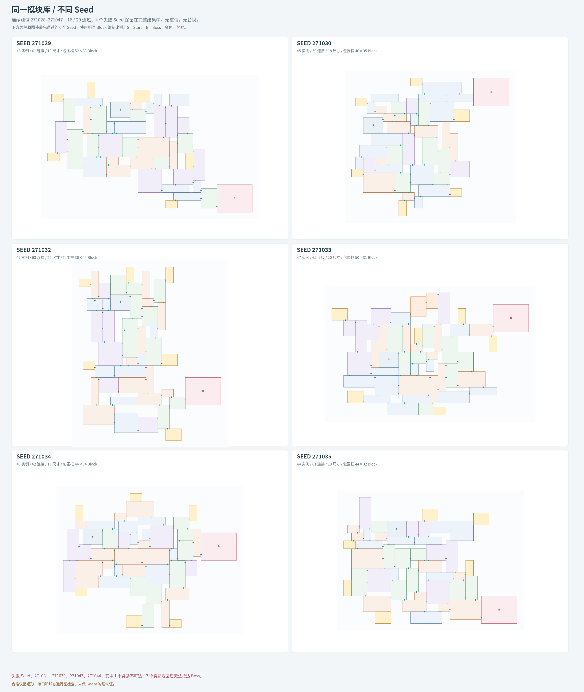

# 《失序之钟》Map Generator

Godot 运行入口（0.1.0 接入候选）：[安装、主游戏调用与验证边界](docs/GODOT_RUNTIME.md) · [真实模块/固定 Seed/连续回放报告](reports/runtime-v1/README.md)。使用锁定的 map-edit modules 1.0.0、实例 Port 子集与齿轮封口；游戏调用全部为 GDScript。

以不重叠的矩形 Module、边界 Block 上的 Port 和显式有向 Route，生成连续二维探索地图。

当前保存的是可复现的布局与静态图原型，以及 20 个 Seed 的完整评估。真实 Module 来自 [map-edit](https://github.com/zhipijun1996/map-edit)，该仓库正在迁移新格式；正式数据接入尚未实施。

## 当前进展

- **算法：** Port 前沿约束生长、候选评分与随机选择、局部有界 Beam Search 闭环。原点由 Port 对齐求出，没有预设水平路线带。
- **当前测试库：** 52 个基础占位模板。Module 仍为矩形，Port 可位于不同边界 Block，同一侧可以有多个 Port。
- **单图样例：** Seed `271028`，49 个实例、37 种模板、18 种尺寸、61 处连接、6 处奖励。
- **批量结果：** 连续 Seed `271028–271047`，首次生成 16/20 通过，4/20 拒绝；没有重试或替换 Seed。合格图有 43–49 个实例，全部实例可达，六处奖励有合法去向。
- **制作建议：** 首批 60 个独立内容任务，附每个任务的矩形尺寸、Port 所在 Block、初始权限与目标 Route。建议库没有替换本次受测库。



上图使用相同 Block 比例，展示原图以外按顺序最先通过的六个 Seed。完整首次结果包含全部失败：[20 次结果图](experiments/seed-study/output/all-20-seeds.png)、[CSV](experiments/seed-study/output/results.csv)、[JSON](experiments/seed-study/output/results.json)。

## 看图与数据

- [单张地图](prototype/output/map.png) · [SVG 高清图](prototype/output/map.svg) · [Block / Port 接缝放大](prototype/output/port-detail.png)
- [已用模板与 Port 分布](prototype/output/module-atlas.svg)
- [60 个推荐制作任务的形状与 Port 位置](experiments/seed-study/output/recommended-60-atlas.svg) · [CSV 清单](experiments/seed-study/output/recommended-60-tasks.csv)
- 单图检查器：下载或 clone 后，用浏览器打开 `prototype/output/map-inspector.html`。
- 多 Seed 检查器：用浏览器打开 `experiments/seed-study/output/seed-inspector.html`，可切换全部 20 个 Seed。合格图可缩放、点击 Module 和接缝；失败 Seed 显示拒绝记录。

矩形内标有实例 ID、模板 ID 和尺寸，`MX` 表示水平镜像；接缝标 `C` 编号，箭头是初始方向。每个小格为 1 Block，Port 落在选定边界 Block 的外侧边中心。GitHub 文件预览不执行交互 HTML，请在本地浏览器打开。

## 运行与复现

核心程序仅依赖 **Python 3.10+ 标准库**，不调用在线大模型。

```sh
# 核对单图和完整存档
python prototype/verify.py
python tools/verify_progress.py

# 重放全部 20 个固定 Seed，独立验证、核对原图或原拒绝结果
python tools/verify_progress.py --replay

# 用另一个 Seed 生成新实验，不覆盖旧批次
python prototype/generate.py --seed 12345 --out /tmp/map-gen-seed-12345
```

`generate.py` 遇到静态验证失败会报错，不把该候选当作有效地图输出。目前已知部分 Seed 会因为奖励可达或回程问题失败。

复现单图 SVG / HTML（写入 `prototype/output/`，先提交或保存自己的改动）：

```sh
python prototype/generate.py
python prototype/render.py
python prototype/detail.py
```

`detail.py` 演示的是固定样例 `271028` 的 C33 接缝。当前单图展示脚本也围绕这个固定样例编排；其他 Seed 请用单独输出目录保存数据，或使用多 Seed 展示流程。

原批量脚本为 `experiments/seed-study/run_batch.py`。它在 `experiments/seed-study/output/` 写结果，保留此目录中的原批次；新实验应复制工作区或指定新的版本目录。`--replay` 验证使用临时目录，不覆盖旧结果。

SVG 是程序直接绘制的工程图。重新导出已提交的 PNG 可选安装 Playwright：

```sh
python -m pip install playwright
python -m playwright install chromium
python tools/export_png.py
# 已有系统 Chromium 时可指定 --browser-executable /usr/bin/chromium
```

## 推荐库配额

| 尺寸族 | Block 尺寸与数量 | 基础模板数 |
|---|---|---:|
| 短连接 | 2×2：4；3×2：4；2×3：4 | 12 |
| 标准 | 4×3：9；3×4：9 | 18 |
| 横向 | 5×3：4；6×3：4 | 8 |
| 纵向 | 3×5：3；3×6：4 | 7 |
| 枢纽 | 4×4：3；5×4：3；6×4：3 | 9 |
| 大型 / 专用 | 6×5：2；6×6：2；8×6：1；10×6：1 | 6 |
| **合计** | | **60** |

普通穿越以 2–3 Port 为主，枢纽 3–5，开阔空间 4–6。水平双侧接口的初始制作目标约同高 30%、错一格 50%、错两格及以上 20%，再按失败签名补缺。这个比例是制作建议，不是本次实测分布。

职责配额是穿越 33、枢纽 9、奖励 9、开阔 6、起点与 Boss 3；它与尺寸配额描述的是同一批 60 个任务。镜像和同一 Module 的 Port 子集不增加基础模板数量。

## 当前边界与下一步

4 个拒绝 Seed 为 `271031、271039、271043、271044`：1 个奖励不可达，3 个奖励后无法抵达 Boss。相关邻接模块虽然有 L/U/D，但真实 Route 没有 U↔D；另一个出口受到单向结构约束，不能假设同属一个 Module 就能任意转接。见[失败诊断](experiments/seed-study/output/failure-diagnosis.json)。

接下来应将奖励可达与回程检查前移到候选放置阶段，补充有明确回程合同的连接模板，并按 map-edit 迁移后的格式实现导入与版本绑定。当前 AIR 回路仅在 7/16 张合格图中接入；三条数学通路示例不等于三种成熟的玩法路线。

全部模板仍只有占位几何和声明 Route，**没有 Godot 物理认证**，没有真实 Cell、动作、接缝、封口或镜像验证。静态图通过不表示已经得到正式可玩地图。

## 文档与目录

- [基础模型与强制契约](docs/MAP_FOUNDATION.md)
- [生成算法与 Module 库指南](docs/MAP_GENERATION_GUIDE.md)
- [进展、结果与格式接入边界](docs/PROGRESS.md)
- `prototype/`：当前可运行原型与单图样例。
- `experiments/seed-study/source/`：原批次冻结源码；SHA-256 见结果 JSON。
- `experiments/seed-study/output/`：全部合格地图、拒绝候选、原始诊断、图表和推荐库。
- `tools/`：存档验证、固定 Seed 重放和可选 PNG 导出。
