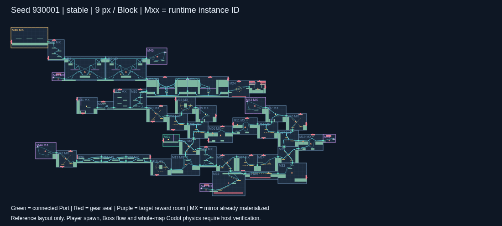

# 主游戏首版交付

[下载 0.1.0 ZIP](releases/0.1.0/mapgen-delivery-0.1.0.zip) · [SHA-256](releases/0.1.0/mapgen-delivery-0.1.0.zip.sha256) · [交付校验记录](releases/0.1.0/receipt.json)

包内包含固定 `seed 930001 / stable / 41fe15d` 地图、每实例完整物化内容、原版 map-edit 1.1.0 模块包、格式契约、JSON Schema、单图参考、独立校验器和主游戏 Codex prompt。它是主游戏装配的输入，尚不是可直接运行的游戏。

[包内阅读说明](templates/README.md) · [格式契约](templates/CONTRACT.md) · [给主仓库 Codex 的 prompt](templates/MAIN_GAME_PROMPT.md)

[8 项交付测试](validation/tests.log) · [最终 ZIP 的独立验收](validation/final-package.json) · [原实验保护及 20 seed 重放](validation/original-checks.log)



独立校验解压包：

```sh
cd mapgen-delivery-0.1.0
python verify_delivery.py
```

在本仓库校验 ZIP 或重建新目录：

```sh
python delivery/verify.py delivery/releases/0.1.0/mapgen-delivery-0.1.0.zip
python delivery/build.py --out /tmp/mapgen-delivery-rebuilt
python delivery/test_delivery.py
```

构建和独立校验仅依赖 Python 3.10+ 标准库。构建使用冻结实验，不重新生成地图；拒绝覆盖已有目录。输入为原受测模块 ZIP 和已保存的固定地图，首次缺少原 ZIP 时按锁定 URL 下载并核验。PNG 是已保存的固定参考，构建时不需要浏览器。测试可额外使用 `jsonschema` 核查 JSON Schema；独立文件、几何和图校验不依赖它。

46 个实例、55 处连接、31 个镜像、40 个封口、18 个怪物记录、11 个奖励点，其中 6 个目标奖励房。原生模块/Port ID、完整怪物和奖励、实际有向图均和源实验逐项核对。封口丢失、Route 反向、旧别名残留、怪物/奖励丢失、重复主路、伪造物理通过等反例会被拒绝。

出生落点、Boss 战斗/结束流程、物化内容的 Godot 构建入口与全图物理测试明确留给主游戏接入；包内记录具体缺口。原模块包及旧实验未修改，不移植生成算法，不更换玩家物理参数。
