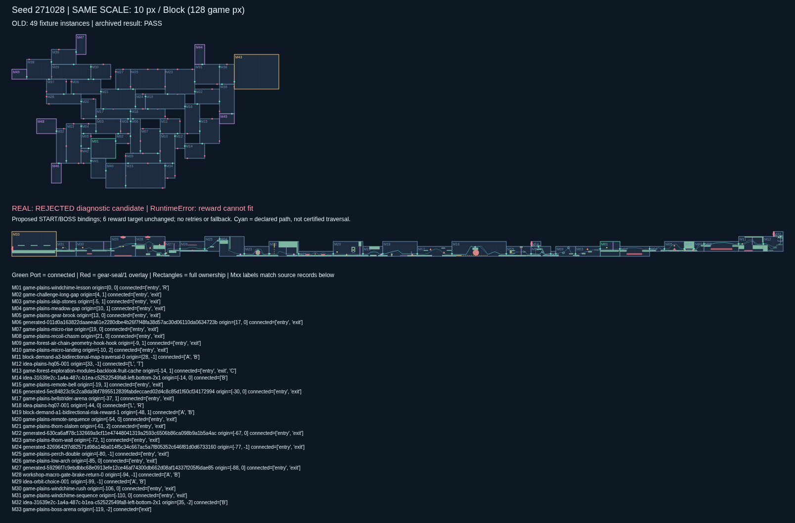

# 旧实验算法 × map-edit 真实模块包：同 seed 验证 v1

本实验从 `c2ac2c3625f659364b187592c836c5ff2bceb892` 新建分支。**旧实验已精确复现；真实模块版当前没有满足原目标的合格地图。** 保留全部 20 个 seed 的真实布局失败候选，供判断数据适配后的效果与缺口，不发布为有效地图。

- [20 seed 地图对照页](output/comparison.html)（下载仓库后浏览器打开）
- [271028 同比例对照 PNG](output/seed-271028/comparison.png) · [SVG](output/seed-271028/comparison.svg)
- [271032 同比例对照 PNG](output/seed-271032/comparison.png) · [271033 Boss 放置失败对照 PNG](output/seed-271033/comparison.png)
- [齿轮封口放大图](output/gear-seal-detail.png) · [SVG](output/gear-seal-detail.svg)
- [逐 seed 汇总](output/summary.json) · [原始运行结果、参数、旧图重放哈希](output/results.json)
- [具体 Module / Port / Route 缺口](output/adapter-feedback.json) · [每个候选的兼容问题](output/compatibility-issues.json) · [独立几何/有向图检查](output/audits.json)



## 结果与验收状态

| 项目 | 旧实验 | 真实模块版 |
|---|---|---|
| seed | 连续 271028–271047 | 完全相同，无筛选 |
| 原算法结果 | 16 PASS / 4 FAIL | 20 REJECTED |
| 复现 | 20/20 JSON 和文件 SHA-256 与原件相同 | 20/20 原算法状态、失败候选和封口数据精确重放 |
| 实例数 | 成功图 43–49 | 失败候选 32–42 |
| 生长目标 | 32 | 32 |
| 奖励目标 | 6 | 6；当前未能放置 |
| 真实库 | 52 个占位模板 | 校验并导入全部 115 个交付模块，候选使用了 101 个 |
| 未用 Port | 占位局部封口假设 | 186 个 `gear-seal/1` 实例覆盖层规格 |
| 物理认证 | 无 | 本轮未运行 Godot；接缝、封口与整图均未认证 |

17 个 seed 在旧 `finish()` 的奖励放置阶段报 `RuntimeError: reward cannot fit`。`271033 / 271037 / 271047` 更早报 `RuntimeError: boss cannot fit`。没有重试、备用图、缩减目标或放宽检查。失败目录只提供 `failed-candidate.json`，没有 `map.json`。

几何和接口检查在全部候选通过：整数矩形不重叠、owned rectangle 相对坐标、边界 Block 中点、接缝精确同点/反向/同地貌/初始权限、未用 Port 与封口一一对应、封口矩形全部在所属 Module 内。**这不等于有向路线可达或候选合格。** 忽略能力认证差异、仅按声明路线检查时，也只有 `271038 / 271039 / 271043` 的旧 Boss 图节点可达；20 张候选都存在有向不可达实例。详细实例 ID 和源 Module ID 在 `audits/seed-*.json`，完整图边也保留。

## 生成算法与参数没有改变

`adapter.py` 和 `run.py` 直接导入原件 `../seed-study/source/generate.py`、`model.py`。没有复制或重写算法，没有引入 PR #1 的 GDScript 求解器。`Observed` 子类只记录阶段，每个重写方法都原样调用 `super()`；不增加 RNG 调用。

原来的候选评分、随机选择、32 实例生长、前沿最多 22 个、局部闭环 3 次/深度 3/Beam 18/源前沿 24、AIR 闭环尝试、远端 Boss 放置、6 个奖励、实际图断言和最多提取 3 条主路全部保留。能力仍是 `{jump, double_jump, recoil, grapple}`。需要区分：3 次闭环是尝试次数，3 条路径是原实现的提取上限，不能改称成功生成保证。每 seed 超时仍为 90 秒，重试为 0。

旧源码/输出、`prototype/`、基础文档与旧验证工具未改动；根 README 仅新增实验入口。旧版 4 个拒绝仍为 `271031 / 271039 / 271043 / 271044`，没有把原失败改成通过。

## 数据来源、角色绑定和适配边界

使用 PR #1 引用的已交付 **map-edit modules 1.0.0**，不是重新制作的模块，也不是下载最新设计稿替换模块：

```text
ZIP 发布文件提交：1776e80bbcaaebad8ad69c23e0de5df38fcc5c95
包内源提交：e2276cc83852272e4520c0b7a450792031b587ee
ZIP SHA256：35a9fcec22bf9defcb93d3683e3b3aed4f928526fe099a72f6b5168a7bb20db3
catalog SHA256：2d1aca9e91ba8a3e209f5484b69b045ae190ab8568bf419c6725f18068fd9809
```

运行前验证 ZIP、版本、目录哈希和 manifest 中全部 **656 个文件**。包内 3 个上游排除项保留原理由，未作为 115 个可读取模块使用。未安装宿主、运行模块工厂或更改 map-edit。

`local2 = 2 * (source_port_position - bounds_origin) / blockSize`，保留真实 ID、尺寸、全部 Port、初始权限、全部声明有向 Route、内容版本、场景路径和场景偏移。只把 `shot_recoil` 拼写映射为旧版 `recoil`，不把 `wall_climb` 当成已有能力；不补反向边，不把同模块内的 Port 当成任意互通。模块包不授权镜像，因此导入模板的 `allow_mirror_x=false`；原算法仍读取该字段决定可用变换。

原算法用字面角色 `START.R`、`BOSS.L` 及 `T* / Q* / AIR_A / AIR_B` 分类。包中没有专用 START。为预先提供可审阅的地图效果，**本批图使用待用户确认的提议绑定**：

| 算法角色 | 真实 Module | 接口别名 |
|---|---|---|
| START | `game-plains-windchime-lesson` | `exit → R` |
| BOSS | `game-plains-boss-arena` | `entry → L` |

两模块全部 Port 和 Route 都保留，不把它们裁成旧夹具的一口模块。模板键是角色别名；每实例另存真实 `source_module_id`，Port 保存 `source_port_id`。这不是已获确认的角色选择，也不是室内出生点/Boss 目标路径认证。`proposed-bindings.json` 清楚标为 `PROPOSED_NOT_USER_CONFIRMED`；**不传 `--bindings` 时真实版直接报告角色缺失，不暗中使用旧占位 START/BOSS**。无绑定的缺口在 `adapter-feedback.json.strict_unbound_preflight` 中。

## 具体兼容缺口

1. **奖励不能凭“有宝箱”计入目标。** `idea-plains-hq04-001` 的 `L-to-L` 和 `idea-spec02-s13-001` 的 `L-to-L` 虽有真实 `reward` 宝箱，但 `resourceProfile` 是 UNKNOWN，没有 `requiredRewards`。未导入 PR #1 的人工奖励覆盖项，也未擅自关联奖励。`b31-n08-reward-return-interface0 / reward-outbound`、`b31-n12-three-side-port-interface0 / high-investment`、`b31-n16-west-low-east-high-interface0 / A-to-B` 有明确奖励关联，但属于多口穿越路线，不能无损当成旧算法的单口奖励折返夹具。候选可包含有宝箱的穿越模块，但不冒充完成原 6 个奖励角色目标。逐模块条目见 `adapter-feedback.json.module_feedback`。
2. **AIR 角色缺口。** 原 `AIR_A` 要求侧面 ROCK 入→侧面 AIR 出，`AIR_B` 要求侧面 AIR 入→侧面 ROCK 出。包内 AIR 口是顶入或底出，没有上述侧向组合。`batch30-block-n04-0-2.E`、`game-boss-approach.C/D` 为顶边 AIR INPUT；`batch30-n11-e-e-width96.C` 和 `generated-c234da4022051a1194ce251aa0da25d06ee572aa2a1c58873f8843f6d934feb2.exit` 为底边 AIR OUTPUT，不能自行迁移到左右侧。原算法尝试返回 `air_connected=false`，未新造连接模块。
3. **能力集合的证据不匹配。** 真实包只有 5 种见证集合，全部不等于旧版四能力集合；最低要求和能力超集单调性没有认证。本实验保留原能力做声明布局诊断，不把“旧算法的集合包含见证能力”写成可正式使用。20 个候选共 1,521 次保留 Route 出现记录了不匹配（含重复实例和 seed，不是 1,521 条独立路线）。`library-feedback.json.ability_witnesses` 按模块/路线列出全部 311 条声明的见证集合。`game-challenge-long-gap` 和 `game-plains-recoil-chasm` 还分别要求 `original-fixture-1j2s / 2j2s`，旧版没有对应宿主配置绑定；保留 16 次实例记录。
4. **Boss 和有向链问题。** 真实 Boss 是双口单向 `entry-to-exit`，与原单口 BOSS 夹具不同；原候选选择有时对接其 `exit`，这不能获得 `BOSS.L:arrive`。例如 `271028/M33` 接的是 `exit`。真实库有许多仅 A→B 的模块，几何生长也可以从反向接上，因此连成矩形链并不保证从 START 可行进。独立图检查如实列出不可达实例；不反转 Route 或更换 Boss 评分。
5. **封口与原认证范围不同。** 原包只授权 `original-all-ports`、identity/translation。`gear-seal/1` 是本次下游独立覆盖层，不改原包，也不把 Port 子集伪称为原包已授权配置。167 次实例出现需要新的封口子集物理证据。已删除任一端点封闭的 Route，保留其他全部声明路线；对作者路径按 24×36 玩家身体扩张后做保守静态相交检查，本批未发现相交。该结果不能升级为封口不破坏真实动作、机关所有状态或无额外越界连接的证明。

## 视觉差异来自哪里

相同 seed 不是相同随机选择序列的几何结果：模块池大小、枚举顺序和每步有效候选数变化，改变了后续 RNG 消耗；同一个随机数也会落到不同模板。评分和种子保持不变。

旧生长库的普通模板有 4–6 个分布于多边的 Port，并允许水平镜像；真实候选放置中有 **542/708 个实例只有 2 个 Port**，常见是左右连接，且所有模块禁用镜像。原评分的包围盒扩张惩罚会让 `game-plains-micro-landing`、`game-plains-micro-rise`、`game-plains-meadow-gap` 等小型连接经常被选中，之后形成较细长的链。旧批次包围盒宽/高中位数为 **47×33 Block**，真实失败候选为 **92.5×14 Block**。这是本批观测及评分机制的解释，不是修改评分后的改善结论。

旧图已经经过 Boss/奖励装配，真实图在该阶段被拒绝，因而实例数、分叉和奖励数量也包含“终止阶段不同”的影响；不能把失败候选与旧成功图的差异全归因于真实地貌。20 张 SVG 均上下使用相同的 10px/Block 比例；真实平台、危险区、机关和作者路径按原数据绘制。移动平台等只显示结构与轨迹，不表示特定时刻物理回放。放大图展示未用 Port 的完整 128px 通口、向内 32px 厚的齿轮覆盖层。

## 复现与检查

Python 3.10+ 标准库即可完成生成、验证和 SVG/HTML。第一次需要下载锁定 ZIP；后续使用哈希匹配的本地缓存。所有新批次必须指定新目录，默认拒绝覆盖已有结果。

```sh
# 原实验独立重放，不覆盖原件
python prototype/verify.py
python tools/verify_progress.py --replay

# 默认无角色绑定：明确记录角色缺口
python experiments/legacy-real-v1/run.py --out /tmp/legacy-real-unbound-v1

# 复现本批提议绑定的诊断结果：先完整复现旧实验，再运行真实版
python experiments/legacy-real-v1/run.py \
  --bindings experiments/legacy-real-v1/proposed-bindings.json \
  --out /tmp/legacy-real-replay-v1
python experiments/legacy-real-v1/report.py --out /tmp/legacy-real-replay-v1

# 包哈希拒绝、角色/Route 保真、坐标偏移、四面封口与 20 候选精确重放
python experiments/legacy-real-v1/test_adapter.py
```

可选 PNG 导出沿用原仓库工具，需 Playwright/Chromium：

```sh
python tools/export_png.py \
  experiments/legacy-real-v1/output/seed-271028/comparison.svg \
  experiments/legacy-real-v1/output/gear-seal-detail.svg \
  --browser-executable /usr/bin/chromium
```

本轮仅完成旧实验复现、真实数据适配、失败布局效果与缺口验证。Godot 移植、主游戏接入、封口物理认证和真实全图可玩性留待后续；本分支没有加入 PR #1 的 Godot 文件或算法。
