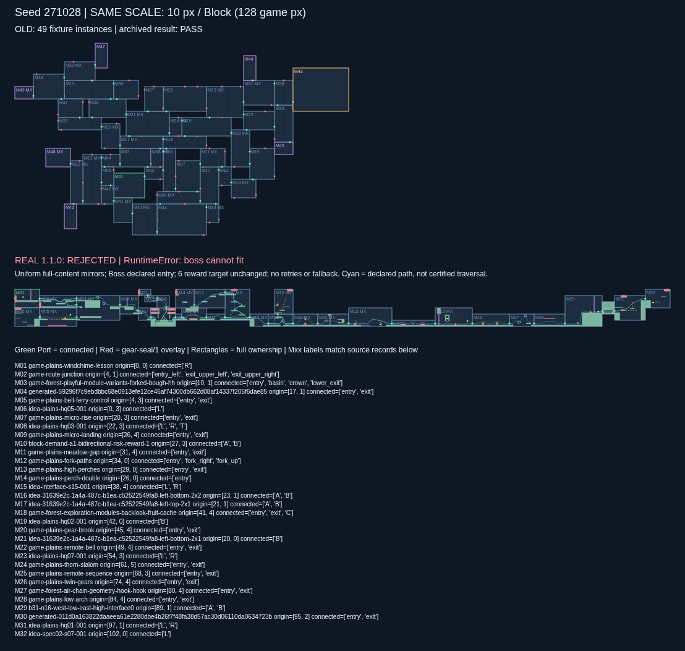

# 旧实验算法接入真实模块包 1.1.0

已读取并验证用户指定的 **map-edit modules 1.1.0**。奖励、Boss 入口、统一镜像和部分 Port 配置已接入；原算法、默认参数及全部检查保留。**最终 20 个固定 seed 仍全部拒绝，这次有实际候选、接口和路线证据，不能解释为没有识别宝箱。**

[20 seed 对照页](output/comparison.html) · [逐 seed 汇总](output/summary.json) · [具体路线断点](output/failure-explanations.json) · [全部原始结果](output/results.json)



[生长阶段耗尽样例 271029](output/seed-271029/comparison.png) · [奖励阶段拒绝样例 271037](output/seed-271037/comparison.png) · [镜像与齿轮封口放大](output/gear-seal-detail.png)

## 包与适配结果

```text
版本：1.1.0
SHA-256：5ad5a7871941b2c1ffa759b18f7b1e80f2fe7e571b72f95d1e0ef26031f08723
发布文件提交：47aefebe07f4f0e7471f3d1546214502a6b2aade
包内源提交：02b5cb53b06d7009225b2ecff9351f315e46b12e
```

校验 ZIP、目录及 manifest 内全部 **657 个文件**。导入 115 个独立基础模块，保留上游 3 个排除项及原理由。包从已校验 ZIP 原子解压；缓存只读并逐文件验证，避免并发重放/报告时互相覆盖文件。

- **奖励识别：** 31 个模块、32 处真实奖励全部保留。26 个模块有明确的 `requiredRewards`，包括已补齐的 HQ04、S13。包仍有 5 个模块的宝箱没有确认的领取路线：保留宝箱、原路线及未知项，不伪造关联，也不删除模块。
- **用途灵活性：** 有取宝路线的多口模块同时可承担穿越和奖励职责。旧算法用 `T* / Q*` 分派，因此适配器提供角色别名，底层共享同一份模块内容和路线；没有为角色、镜像或 Port 子集复制基础模块。奖励候选数为 26，不再错误地要求整个模块所有路线都取宝。
- **统一镜像：** 包无镜像开关。适配器给旧求解器的内部 ABI 统一提供 `allow_mirror_x=True`，每个基础模块都搜索原朝向与水平镜像。输出物化完整编译内容，包括平台、机关、矢量方向、奖励、路径、移动轨迹及对应引用；Route 保持原 `from→to`，不自动反向。所有内容先转换到 owned rectangle 像素坐标，避免源 bounds 偏移重复应用。
- **起终点 Port 子集：** 起点沿用既有明确配置 `game-plains-windchime-lesson.exit`，出生语义仍是旧实验的边界出发；Boss 使用 `purpose=boss_arena` 的 `game-plains-boss-arena.entry`，并核对 `entryPortIds`。两角色向原求解器各开放一个接口，其余真实接口仍保留并自动封口。没有修改物理权限，也没有把 Boss 的 `exit` 冒充到达入口。
- **部分 Port：** 普通模块仍由原算法决定实际连接子集。全部未用接口生成 `gear-seal/1`，覆盖 128px 通口、向内厚 32px；删除封闭端点涉及的 Route，并检查保留作者路径与封口的保守净空。封口含实体矩形规格和齿轮图示，没有宣称完成 Godot 物理认证。

`content` 已在所属矩形坐标系物化，`scene_origin_offset` 和 `source_affine` 是来源/变换描述，不能再对已物化坐标重复应用。椭圆轨迹用 `ellipse_x_sign` 保存反射后的参数方向，测试核对同一时刻的反射位置；未来 Godot 消费者需要实现这一描述，本轮没有提供运行时安装器。

## 最终固定批次

所有 seed 均为 **271028–271047**。旧实验再次重放，20/20 地图或拒绝候选与原存档文件 SHA-256 一致，仍为 16 PASS / 4 FAIL。最终真实版全批运行前后核对适配源码及配置哈希，无 seed 筛选、失败后修图或替代布局。

| 最早拒绝阶段 | 数量 | seed |
|---|---:|---|
| 生长候选耗尽，未达到 32 个实例 | 7 | 271029、271031、271040、271041、271043、271044、271045 |
| 已生长，Boss 无合法几何位置 | 10 | 271028、271030、271032、271033、271034、271035、271036、271038、271039、271046 |
| Boss 已放置，后续奖励放置耗尽 | 3 | 271037、271042、271047 |

候选包含 **7–34 个实例、271 个镜像实例、118 个未用 Port 齿轮封口**。只有 271037、271042 各放入 1 个目标奖励实例，均未满足原 6 个目标；没有因模块本身已带其他宝箱而扣减原 `finish()` 的 6 次奖励放置目标。所有失败目录只保存 `failed-candidate.json`，不发布合格 `map.json`。

每个候选保留：

- `legacy-state.json`：原算法停止时的状态。
- `failed-candidate.json`：真实内容、完整镜像结果、全部 Port、封口、有效有向路线、奖励关联及独立图检查。
- `placement-diagnosis.json`（Boss/奖励失败）：逐前沿接口、匹配模块和镜像、求出的原点、碰撞到的具体实例；可核对符合原角色规则的可放候选数确为 0。
- `comparison.svg`：与旧实验同 seed、同 10px/Block 比例的上下对照，不把失败候选画成成功地图。

生长阶段的补充全前沿审计在 `failure-explanations.json`：7 个失败 seed 的剩余完整前沿可放穿越候选数均为 0，不只是原算法采样前沿恰好漏掉可放项。

## 差异和实际缺口

1. **奖励数据已经可读，拒绝不是奖励池为空。** 候选池有 26 个真实奖励模块。原 `finish()` 只尝试在已有前沿放置，不会为了奖励回溯重排生长阶段，也不会凭空把未连接的奖励出口补回主网络。用 1.1.0 仍失败，是所生成前沿下的实际放置结果。具体重叠及接口缺口见逐 seed 的放置诊断。
2. **真实模块多数为双口，原评分容易形成窄链。** 最终放置的 538 个实例中有 464 个双口模块；旧批次的普通夹具有大量 4–6 口，并有较多声明的双向路线。保持原评分后，本批包围盒宽/高中位数由旧版 **47×33 Block** 变为真实候选 **66.5×9.5 Block**。同 seed 只固定 RNG 初始状态；数据池、有效候选及其遍历改变，后续 RNG 消耗和实际选择会改变。
3. **几何接通不等于有向通行。** 例如 271028 的 `M03 / game-forest-playful-module-variants-forked-bough-hh` 有多个侧口，但只声明 `entry→crown`。从 `lower_exit` 或 `crown` 到达时不能编造返向出口。报告保存 START 到每个已到达死端的完整图节点路径及该口实际声明的出路线。全部几何/封口覆盖检查通过；19 张候选有不可达实例，20 张都尚未建立 START→Boss 的有效通路。
4. **AIR 组合仍有明确缺口。** 原 AIR_A/AIR_B 寻找侧面 ROCK→AIR、侧面 AIR→ROCK 组合。现包没有此类侧向组合；没有把顶部 AIR INPUT 或底部 AIR OUTPUT 迁移成侧口。原 AIR 尝试保持失败，未造新模块。
5. **旧奖励图是模块级假设，真实关联是路线级事实。** 冻结 `assemble()` 会给奖励实例的每条有效路线插入奖励相位。新报告另建按实际 `requiredRewards` 分段的完整有向图，只给真正关联奖励的路线插入领取节点；不把普通回程或旁路伪称取宝。原装配检查仍完整执行，不以新图绕过原拒绝。

这些结果不能通过继续补几项包字段就保证成功。**本轮读取所需的核心字段已满足；要提高通过率，需要另行允许调整原算法的候选选择、路线前提或闭环/奖励放置策略。当前没有做这些修改。**

能力见证集合、原生 profile、镜像/封口和接缝物理范围保留为单独的 `physical_notes`；没有把认证 UNKNOWN 新增为本轮静态布局拒绝门槛，也没有声称它们已经认证。检查源能力集合时仍使用旧默认四能力和原来的子集过滤。

## 算法、验证与复现

生成直接导入 `../seed-study/source/generate.py` 和 `model.py`，未编辑冻结源码。保留 32 生长目标、3 次深度 3 闭环、Beam 18、前沿 22、闭环源 24、六次奖励放置、原全部断言、默认四能力、每 seed 90 秒上限和零重试。3 次闭环是尝试次数，最多提取 3 条主路是原实现的上限，没有改称必然成功保证。

```sh
# 原实验验证与重放
python prototype/verify.py
python tools/verify_progress.py --replay

# 新目录运行：先重放旧批次，再用 1.1.0 跑同批 seed
python experiments/legacy-real-v2/run.py --out /tmp/legacy-real-110-new
python experiments/legacy-real-v2/report.py --out /tmp/legacy-real-110-new

# 如旧批次已精确重放，可验证其哈希后复用，不重复生成旧图
python experiments/legacy-real-v2/run.py \
  --baseline-from experiments/legacy-real-v2/output/results.json \
  --out /tmp/legacy-real-110-repeat

# 全部内容变换、真实图关联及全部 20 个原状态/候选精确重放
python experiments/legacy-real-v2/test_adapter.py
```

生成和 SVG/HTML 仅用 Python 3.10+ 标准库。PNG 导出沿用仓库 `tools/export_png.py`，可用 Playwright/Chromium。对照 HTML 可本地直接打开，或在输出目录运行 `python -m http.server 8000`。

[测试日志](output/validation/adapter-tests.log) 覆盖所有 115 个模块的双重镜像还原、炮台方向、奖励区域、椭圆同时间位置、Port/Route 引用、终点隐藏口封闭、并发原子读包及全部 20 个真实候选精确重放。完整哈希清单在 `output/SHA256.json`。中间适配实验原件与对应源码压缩保留于 `exploration/`，不用于挑选最终 seed 或替换最终失败。

本轮没有 Godot 移植、物理遍历或主游戏接入。旧实验与 v1 目录保持原样。
