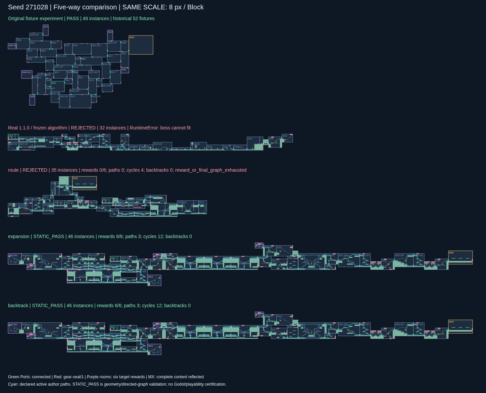

# 真实模块优化实验 v1

本轮不改 Module 库，继续使用 **map-edit 1.1.0 / SHA256 5ad5a787…31f08723** 和同一批 seed `271028–271047`。保留 32 个生长实例、6 个新增目标奖励、真实有向 Route、完整镜像、未用 Port 齿轮封口及原装配断言。

**结果：原真实库基线 0/20；优化后 19/20 通过原静态断言与真实路线独立检查，其中 16/20 同时提取出 3 条不同模块序列的主路。不能把 19/20 泛称为全部达到三主路目标。**

[20-seed 五图对照页](output/comparison.html) · [完整结果](output/results.json) · [统计](output/summary.json) · [三主路严格统计](output/quality-summary.json) · [预先固定的配置](config.json) · [实验方法与 pilot 修订](PLAN.md)



其他代表：[仍失败的 271035](output/figures/seed-271035.png) · [主路不足的 271038](output/figures/seed-271038.png) · [回退救回的 271046](output/figures/seed-271046.png)。全部 20 个 seed 都有 SVG，没有筛掉失败后展示成功率。

## 累积对照

| 变体 | 静态检查通过 | 同时达到 3 条主路 | 拒绝 |
|---|---:|---:|---:|
| 原算法 + 同一个真实库（legacy-real-v2） | 0/20 | 0/20 | 20 |
| route：前置实际入口/路线检查 | 0/20 | 0/20 | 20 |
| expansion：再增加有效出口评分与后继几何检查 | 18/20 | 15/20 | 2 |
| backtrack：再增加有界回退及终端空间修复 | 19/20 | 16/20 | 1 |

原 52 夹具实验仍精确重放为 16 PASS / 4 FAIL，原文件未改。这是历史参考，不与真实库混成同一输入池。

`STATIC_PASS` 要求原 `assemble()` 的断言通过，且独立检查全部实例可达、Boss 到达、6 个目标奖励真实领取及其到 Boss 的去向、不重叠、Port/接缝初始权限、封口一一覆盖和作者路径保守净空。原源码只“最多提取 3 条主路”，并不对数量断言；本报告另行严格统计确实得到 3 条的图，不掩盖这个差异。

`271037 / 271038 / 271045` 虽通过静态检查，分别只有 **2 / 1 / 1** 条提取出的主路；其余 16 张 backtrack 成功图有 3 条。没有把原来的 6 个奖励改成更少数量，也没有用穿越房间中已有的其他宝箱抵扣六次新增目标奖励。

## 修改了什么

`solver.py` 继承冻结的 `Generator`，复用原矩形占用、精确 Port 对齐、候选索引、固定前沿/选择数量、局部 Beam 闭环和最终装配。改动仅在新分支、新目录生效。

1. **实际入口与方向检查。** 出发口必须从 START 经显式有向 Route 可达；候选必须从本次真实接入的 Port 进入，并有实际可用的后续 Route。不会借同一 Port 随意拼接两段路线，也不把镜像当反向路线。
2. **有效扩展评分。** 原面积、重复、位置评分保留，增加有实际 Route 且有几何后继的出口、双向出口及 Boss/奖励候选空间分数。在固定 18 个候选的短名单上做后继检查，所有候选几何求值都计入预算；不能仅凭多了几个 Port 就加分。
3. **有界回退。** 保存前 5 个候选和 RNG 状态，失败时回退最近至多 3 个决策。Boss/奖励也尝试有限候选，并允许至多 8 次生长末端修复。共享终端预算 128，按最多 9 次布局尝试固定分配；不换 seed，不使用备用图。
4. **真实领奖图。** 最终主路从真实 `requiredRewards` 关联图提取，逐边可核对。原装配图及其全部断言仍保留，旧图里模块级奖励相位不会冒充真实宝箱领取事实。

生成预算对三组相同：每 seed 90 秒、最多 500000 次候选求值；生长前沿 22、前 5 随机选择、3 次深度 3 闭环、Beam 18。配置和实现均在完整 benchmark 前冻结，输出含实际运行源码副本和 SHA-256。未修改模块地形、路线、奖励关联、镜像或接口契约。

## 改善来自哪里，还有什么不足

单独前置方向检查能够避免接错路线，但不能避免紧凑评分把前沿消耗完，因此仍是 0/20。有效出口评分与几何后继检查使已有枢纽真正进入选择，主要改善来自这组组合。回退进一步救回 `271046`，没有靠补新模块。

`271035` 在 8 次布局修复、9 次生长回退后仍失败；保存了全部 57 个失败/回退状态。最后状态只有 3 个目标奖励，终端局部预算耗尽，**不是证明真实库无解**。只读补充检查仍找到 1 个可加奖励的候选，但不足以据此证明其余三个能联合放下；见 [remaining-gap.json](output/backtrack/seed-271035/remaining-gap.json)。后续更适合改进奖励空间预留和搜索预算分配，当前证据不足以要求新增 Module。

backtrack 成功图有 44–46 个实例，使用基础模块数中位数 23；全图几何独立环秩中位数 14。该环秩不是有效主路数量或趣味评分。成功图宽/高中位数 **134×18 Block**，仍偏横向；和原夹具的紧凑二维形态仍有差距。沿用的包围盒面积惩罚在图变宽后使增高代价变大，评分尚未直接约束宽高比例。当前证明的是生成目标与声明图改善，不能称为已经得到高质量玩法地图。

下一轮优先项：让 Boss 到达位置和闭环选择考虑主路多样性，提前联合保留六处奖励空间，再改善宽高比例和内容重复；不先盲目扩库。

## 证据与复现

三个 pilot seed 在 benchmark 前固定。pilot-01 的预算分配问题及全部结果原样保留；pilot-02 为 route 0/3、expansion 2/3、backtrack 3/3。完整 20-seed 批次之后没有再调整权重或挑选 seed。这批 seed 已用于历史诊断，是优化/回归样本，**不是独立留出集**。

每例包括：

- `layout.json`：可直接阅读的轻量布局、完整连接、真实主路及 source ID。
- `map.json.gz` 或 `failed-candidate.json.gz`：无损完整记录，包括真实内容、封口、原装配结果和独立图。
- `solver-state.json.gz`、`decisions.json`、`checkpoint.json`：原求解状态、决策轨迹和最后检查点。
- `search-failures.jsonl.gz`：出现的失败与回退状态，不只是最终成功图。
- `result.json`：结果、耗时、候选求值、回退与布局修复次数、结构签名和文件哈希。

主路回放验证剔除的只有实测时间字段，布局、实际图及搜索计数的结构签名保持一致。全部成功图再从原状态独立重建并核对。没有 Godot 移植、真实物理遍历或主游戏接入；物理未知项保留为注记，静态通过不等于可正式拼装。

```sh
# 一次完整 3×20 比较；拒绝覆盖已存在目录
python experiments/optimization-v1/run.py --out /tmp/mapgen-opt-new
python experiments/optimization-v1/report.py --out /tmp/mapgen-opt-new

# 定向反例、全批独立验收、每变体成功/失败代表重放
python experiments/optimization-v1/test_solver.py

# 原实验保护检查
python prototype/verify.py
python tools/verify_progress.py --replay

# 查看完整 gzip JSON
gzip -dc experiments/optimization-v1/output/backtrack/seed-271028/map.json.gz
```

新实验生成、验证和 SVG/HTML 只依赖 Python 标准库。PNG 沿用仓库 Playwright/Chromium 导出工具。对照页面下载后本地打开，或在 output 目录启动 `python -m http.server 8000`。

[8 项测试日志](output/validation/tests.log)。原两批 pilot 的所有案例压缩保存在各自 `layouts.tar.gz`，结果表和源码仍直接保留；在对应 pilot 目录执行 `tar -xzf layouts.tar.gz` 可恢复。所有成功、失败、源码和归档校验信息都保留。
