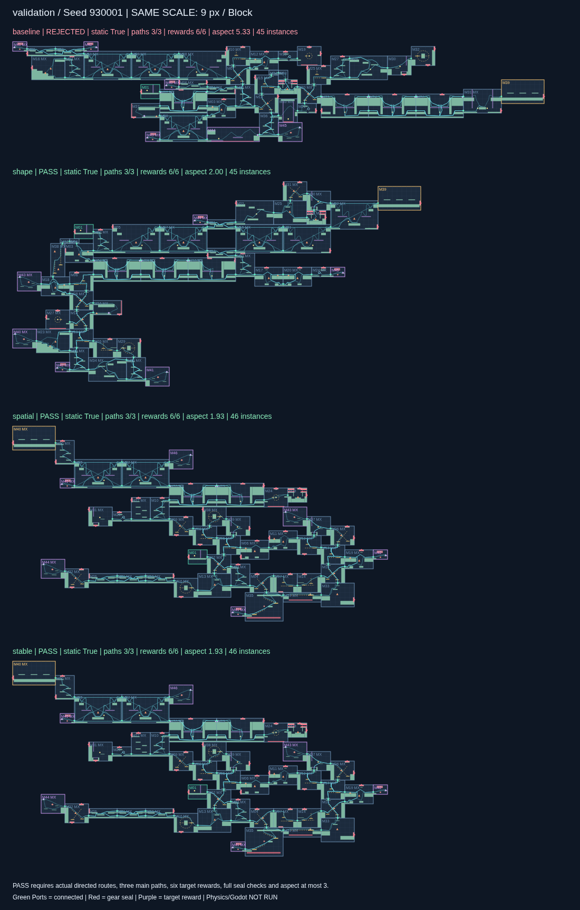

# 地图效果稳定性实验 v2

继续使用 map-edit **1.1.0**，包 SHA-256 为 `5ad5a7871941b2c1ffa759b18f7b1e80f2fe7e571b72f95d1e0ef26031f08723`。模块内容、Port、Route、奖励关联和完整镜像规则均未修改。旧算法、旧实验及其失败原件保留，本轮优化只在本目录生效。

[全部同 seed 地图对照](output/comparison.html) · [结果明细](output/results.json) · [分组统计](output/summary.json) · [固定配置](config.json) · [运行前的实验方案](PLAN.md)

本轮 `stable` 配置在历史回归组 **20/20**、未见验证组 **20/20** 达到完整门槛；160 个对照案例全部保留，程序错误及超时为零。可以将此版本的配置和验收规则固定下来，作为下一轮回归基准。这个结论限定于本批静态生成验证，不是所有 seed 必然成功的证明。



[首个历史 seed 对照](output/figures/calibration-271028.png) · [原纵向评分版仍略超宽高比的 271045](output/figures/calibration-271045.png) · [通过回退补齐主路的 930012](output/figures/validation-930012.png)

## 完整结果

“完整通过”同时检查形态与生成目标；“形态通过”也列出部分或目标不足的候选，因此不能单独看这一列判断成功。宽高比分布只统计三主路、六奖励及静态检查已完整的图，未先过滤长条。

| 样本组 | 配置 | 静态通过 | 三主路六奖励 | 形态通过 | 完整通过 | 完整目标图长短边比 P50 / P95 / 最大 |
|---|---|---:|---:|---:|---:|---|
| 历史 20 | baseline | 19 | 16 | 1 | 1 | 6.19 / 12.00 / 12.00 |
| 历史 20 | shape | 20 | 15 | 20 | 15 | 2.50 / 2.94 / 2.94 |
| 历史 20 | spatial | 20 | 19 | 19 | 18 | 2.45 / 3.03 / 3.03 |
| 历史 20 | stable | 20 | 20 | 20 | **20** | **2.41 / 2.75 / 3.00** |
| 未见 20 | baseline | 20 | 17 | 0 | 0 | 6.50 / 13.50 / 13.50 |
| 未见 20 | shape | 20 | 15 | 19 | 14 | 2.51 / 3.03 / 3.03 |
| 未见 20 | spatial | 20 | 19 | 19 | 18 | 2.38 / 3.44 / 3.44 |
| 未见 20 | stable | 20 | 20 | 20 | **20** | **2.42 / 2.77 / 2.78** |

只修形态不能保证主路充足；真实纵向扩展进一步改善选择，最终目标检查与有界回退补齐余下缺口。`stable` 的 40 张图有 44–47 个实例，高度为 28–41 Block，使用基础模块数中位数为 22。`930003` 和 `930012` 各进行了 1 次布局修复，其余无需布局修复；这两例不能忽略失败尝试，完整回退记录已保留。`271045` 最终长短边比恰为 3，离形态门槛仍没有余量。

上一版宽高比不达本轮新增门槛不代表其旧记录被改成了错误结果。其历史 19/20 静态通过仍成立，本轮统一按更严格的三路、六奖励和形态门槛重新比较。

`stable` 的候选求值 P95：历史组 107175、新验证组 112877；全体最大 121354，低于 500000 预算。对应实测时间中位数 2.69 / 2.99 秒，P95 为 4.89 / 6.00 秒。不同配置按批运行，时间会受负载影响；不能把这组计时直接解释为速度提升。新验证组 20/20 的 Wilson 95% 区间约为 **83.9%–100%**，尚不足以承诺生产成功率达到 99%。

## 如何判断稳定

每张合格图必须同时通过原装配断言和真实声明图独立检查，保持 32 个生长实例、6 个新增目标奖励、全部实例可达、奖励领取后可到 Boss、合法齿轮封口，并且有 **3 条不同模块序列的主路、包围盒长短边比不超过 3**。已有普通房间里的宝箱不会抵扣六个目标奖励。三条图论路径也不代表三种已经验证的玩法路线。

把上一版静态通过、完整目标通过和最终形态通过分开统计，不能只因生成了 JSON 就算成功。新推荐门槛为历史回归组和未见验证组各至少 19/20 完整通过、程序错误及超时为零，另有至少 6 次代表性重放一致。全部失败都保留，不更换 seed，不回退到小图。

历史 `271028–271047` 是已见回归集；`920001–920003` 只用于 pilot 排错；`930001–930020` 是在完整实现冻结后首次运行的验证集。验证集没有用于调整权重。观察到的通过率不能保证所有 seed 都成功；分组统计附 Wilson 95% 区间。

## 改动及边界

四个配置依次叠加，在每个 seed 上都完整运行：

| 配置 | 改动 |
|---|---|
| baseline | 上一版 v1 的 backtrack，作为同库对照 |
| shape | 面积增量评分改为周长增量和软宽高比目标，移除向右及贴近水平轴的偏置 |
| spatial | 再按真实 Route 与可放后继验证纵向出口、不同出口方向 |
| stable | 再用真实单口回程奖励房构造非重叠空间预留，筛选 Boss 入口与三主路，完整目标检查失败则有界回退 |

旧面积评分在宽 100、高 10 时，横向增加 2 格只增加 20 面积，纵向增加 2 格却增加 200，因此会自行放大横向倾向。新评分直接表达形态目标，不设固定横排，不缩放或旋转模块。软目标宽高比 1.5，硬门槛为长短边比≤3；横向、纵向长条都受检查。

奖励预留使用现有真实奖励房的矩形、入口、显式奖励回程 Route 和封口条件构造见证，不拿“空闲 Port 数”冒充六个房间能联合放下。它是保守规划条件，可能排除其他可行组合；最终仍逐例经过独立审计，不修改模块契约。生长阶段排序和终端过滤的作用不同，消融结果应结合阅读。

每 seed 预算沿用 v1：500000 次候选几何求值、90 秒、最多 128 个回退、8 次末端修复和 128 个共享终端状态。采用 4 个独立 worker 并发，计时包含资源竞争，不是单线程性能测评。相同包、配置、实现和 seed 应复现布局、实际图及搜索计数；结构签名只剔除实测时间字段。

## 查看与复现

```sh
# 拒绝覆盖旧实验；一次运行两个组 × 四配置 × 20 seed
python experiments/optimization-v2/run.py --out /tmp/mapgen-stability-new
python experiments/optimization-v2/report.py --out /tmp/mapgen-stability-new

# 单个 seed 的固定配置试验（使用新的输出目录）
python experiments/optimization-v2/run.py --worker --variant stable --seed 930001 --cohort validation --out /tmp/mapgen-stable-930001

# 全案例独立审计、门槛反例、奖励预留与代表性重放
python experiments/optimization-v2/test_solver.py

# 原实验保护检查
python prototype/verify.py
python tools/verify_progress.py --replay
```

对照页可本地打开，或在 output 目录启动 `python -m http.server 8000`。每个 seed 的四张图采用相同 Block 比例；失败候选也会展示。轻量 `layout.json` 保留真实 source ID、镜像、连接、封口和主路；完整内容与独立图在 `map.json.gz` / `failed-candidate.json.gz`，另有原求解状态、决策、失败回退记录及源码快照。`output/SHA256.json` 校验交付文件。

两轮 pilot 的全部案例分别保存在 `pilot-01/layouts.tar.gz`、`pilot-02/layouts.tar.gz`，结果表、运行源码和归档哈希仍直接保留；在对应目录执行 `tar -xzf layouts.tar.gz` 可恢复。这两轮未调整评分权重，第二轮补齐测试、报告与预先固定的推荐判据。

交付验证全部通过：[7 项测试与代表重放](output/validation/tests.log)、[40 张 stable 全量重放](output/validation/stable-replays.json)、[40 个页面切换及 160 个数据链接](output/validation/ui-check.json)、[原 20 seed 精确保护检查](output/validation/original-checks.json)。`stable` 已满足运行前固定的本轮实验推荐门槛；原型默认和冻结源码未替换。页面检查及全量重放脚本也随记录保留。

后续沿用这组配置和失败验收规则，扩大未见 seed 的覆盖，再单独评估内容重复、路线差异与体验节奏。不要把每轮新增权重直接混入同一个版本，也不要拿形态通过冒充玩法质量已稳定。

本轮只验证地图生成与静态声明图效果，Godot 动作、接缝和全图物理认证仍未进行，没有主游戏接入。
