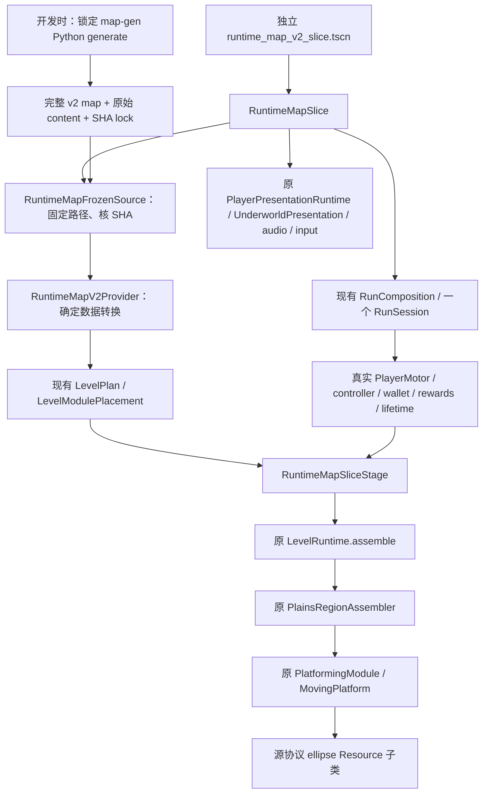

# 第一轮宿主接入：实际边界与逐项映射

基点 main `30e36c9abe223f26e666ceaf796e3fe9cb58e10f`，分支 `feature/mapgen-host-v2-01`。先阅读现行 AGENTS、architecture、architecture_extensions 和 game_architecture_01 的 architecture/ownership/composition_closeout，再核实际消费者；PR123、旧 delivery/v1 和模块包内旧宿主均未恢复。

本轮接通的是**冻结真实内容的受控装载切片**，不是完整地图、正式出发替换或游戏内算法。三个模块的全部内容原样保留。输入与失败见[证据](../../evidence/mapgen_host_v2_01/README.md)，后续责任见[上游要求与第二轮清单](upstream_requirements.md)。

## 实际调用关系



Provider 不读文件、不创建节点、不调用生成器或地图 RNG；Stage 不创建玩家或服务。每实例只装一次原物化内容，模块跨越不切 Stage、不重置角色。旧正式 App/Stage 的旧 Manifest 消费关系仍保留，不借伪造 `legacy_generated` 过关。

## v2 → LevelPlan 映射

“已有”指 main 可复用能力；“适配”指本轮实际新增的有限映射；“不支持”指本轮明确拒绝或未打通。详细原 main 逐行审计在证据归档的 `host-audit.md/json`。

| 项目 | 状态与实际处理 | 实际代码 |
| --- | --- | --- |
| 请求/版本 | 适配：官方 request/config 原件和完整源 SHA 锁定；root_seed 规范化为整数文本。仅接受当前128px、已物化坐标合同；不是通用全 v2 validator。 | `level_request.gd`；`providers/runtime_map_v2_provider.gd:load_level`；`RuntimeMapFrozenSource.read_inputs` |
| 坐标 | 已有平移装配；适配 `origin_blocks * 128 + local_pixel`。矩形/机制保留局部坐标；不加第二次 source offset。 | `game/world/levels/providers/runtime_map_v2_provider.gd`；`game/world/generation/plains_region_assembler.gd`；`game/world/components/platforming_module.gd` |
| 物化镜像 | 适配：要求 `content_is_materialized`、`content_transform_applied`；不调用 ModuleReflection、不负 scale、不执行 source_affine。椭圆仅消费已物化的 x_sign。 | Provider `_instance_error/_content_error/_definition`；`content/runtime_map_ellipse_definition.gd` |
| 内容引用 | 适配：`content_ref` 从宿主传入的 Dictionary 解析。冻结入口按6份原字节核 SHA，map 内模块包 SHA 同锁；不加载 source_scene_ref/source_compiled_ref 指向的旧场景。 | `experiments/generation/runtime_map_frozen_source.gd` |
| 稳定实例身份 | 已有 placement.instance_id / clocks / visited；保留 M16/M18/M21，不用数组下标充当身份。原 instance/content/Ports/routes 全存 definition metadata。跨实例敌人/奖励事务尚未覆盖，后续须沿 `run_id/map_id/instance_id/local_object_id`。 | `level_module_placement.gd`；Provider `_definition`；`RuntimeMapSliceStage.capture_state/observe_player` |
| 地形/单向/封口 | 已有矩形、单向平台和 AnimatableBody2D；适配原 seals 各追加一次，原平台索引不变。20 static + 1 carrier，未建额外 ground supports。 | Provider `_definition`；原 `PlatformingModule._ready` 与 `MovingPlatform` |
| 几何 Ports/连接 | 适配：保留11 Ports、20 routes，核原端点/边界/face/surface/INOUT、3条内部连接及无断开的静态子图。连接 a/b 不代表移动方向。旧 body-center entry/exit 使用源原值且标 helper，不冒充 v2 几何 Port、不造 main_route。 | Provider `_instance_error/_connection_error/_disconnected_instance`；原 `scripts/generation/platforming_module_port.gd` |
| 机制 | 适配真实 `clockwise_ellipse/v1`，复用原 Resource/MovingPlatform/时钟，不移动玩家来伪造骑乘。非空 wall/hazard/thorn/saw/hook/latch 等目前拒绝，即使旧宿主有相近类型，也不算已接入。 | `runtime_map_ellipse_definition.gd`；Provider `EMPTY_FIELDS/_content_error` |
| 敌人 | 不支持本轮物化敌人；原 EnemyFactory/EnemyActor/共享 damage policy 可复用，但敌人关联、本地身份和恢复仍需映射。所选模块敌人数为0。 | 原 `level_runtime.gd`、`game/enemies`；Provider拒绝 `enemies` |
| 奖励/宝箱 | 不支持本轮奖励内容；现有 wallet/reward grant/claimed 继续唯一权威，不用旧随机掉落替换源奖励。所选模块奖励数为0。 | 原 `level_runtime.gd`、`RunSession.create_run_services`；Provider拒绝 `reward_sites` |
| 出生 | 需要宿主绑定：上游整图 player_spawn 是 UNRESOLVED。本轮 `bindings.json` 明示三处测试出生，真实24×36玩家已验证接缝和骑乘；它们不是整图正式出生认证。 | `RuntimeMapFrozenSource.load_level`；`RuntimeMapSlice._ready` |
| Boss/完成 | 不支持：上游 M40 boss_encounter 要求宿主绑定，boss_completion 未解决、原出口有封口。未猜 Boss、开门或伪造通关。 | 原 `BossFactory`、`LevelPlan.boss`；冻结 map.anchors |
| 取消/生命周期 | 已有 run/stage/actor epoch。切片 reload 清输入/弹丸、invalidate_actor；退出 end + 原 WorldAudioLifecycle drain；旧 token 不可提交。同步生成取消/异步 worker 尚未实现。 | `RuntimeMapSlice.reload_slice/close_slice/accepts_result/_exit_tree`；原 `DemoLifetime` |
| 地图记录 | 适配：原 RunManifest.record_output 写独立 `mapgen_v2_loading_slice` 身份；不塞旧 generated_layout。map_hash 为原map SHA+排序选择ID，**不包含宿主bindings/独立content字节**；完整输入锁另存。这不是完整 replay fingerprint。 | `RuntimeMapSlice._ready`；Provider `load_level`；原 `game/application/run_manifest.gd` |
| 恢复 | 已有 PlainsRegionState hash/visited/clocks；实际同图新 Stage 恢复原时钟、玩家位置/钱包/HP不重置。不是永久中途存档、敌人机制全状态或完整 v2 重放。 | `RuntimeMapSliceStage.capture_state`；`RuntimeMapSlice.reload_slice`；原 `plains_region_state.gd` |

以上文件名未写全路径的现有类可由 [architecture](../../architecture.md) 导航；本轮新增文件都在 `game/world/levels/{providers,content}`、`experiments/generation` 和 `tests/runtime_map_v2_runner.gd`，未另造注册表或权威服务。

## 真实输入和选择

map-gen main 固定 `178c40164c2f7371ce1c8a56cde658e84a4f42c2`；使用正式 Python API 和未改的官方 seed930001/stable-v2 请求，首次生成 PASS：46实例、55连接、46份 content。没有重抽 seed、降目标或删内容。

模块包1.1.0：release文件提交 `47aefebe07f4f0e7471f3d1546214502a6b2aade`；包内源提交 `02b5cb53b06d7009225b2ecff9351f315e46b12e`；ZIP SHA256 `5ad5a7871941b2c1ffa759b18f7b1e80f2fe7e571b72f95d1e0ef26031f08723`。两种提交用途不同，不混写。

| 实例 | 原模块 | origin_blocks | 完整内容 |
| --- | --- | --- | --- |
| M16 | idea-spec02-s11-001 | [-3,6] | 4平台（1单向）+1原封口+1原椭圆平台；已镜像 |
| M18 | game-route-junction | [-9,5] | 7平台+1原封口 |
| M21 | game-route-junction | [-15,5] | 7平台 |

原连接 C027（M16.R/M18.entry_left，世界[-384,832]）、C030（M18.entry_right/M21.entry_left，[-1152,832]）和 C031（upper_right/upper_left，[-1152,704]）均保留。实测跨越前两条地面接缝；C031只核静态对齐，未签物理通过。M16 的 `R` 实际 face=LEFT，不能据名字猜朝向。

切割边 C022/C036/C037 明示保留记录，没有擅加封口，切片边缘可离开。最初“纯可支持危险机制相邻对”的扫描为0；此真实选择缺口原样保留。用户允许“交互或危险机制”，因此采用含原椭圆骑乘的三模块方案；没有把无敌/无奖/无危险改说成全功能覆盖。

## 运行与回退

```sh
GUNMAN_TOOLCHAIN_ROOT=/workspace/toolchains bash tools/godot.sh --path . res://experiments/generation/entries/runtime_map_v2_slice.tscn
python3 tools/harness.py --check runtime-map-v2-host --jobs 1 --release
```

第一条为原生编辑工程入口；箭头/A,D移动、原输入提供跳跃/射击、ESC按原音频排空后退出。CI为真实60Hz物理（headless），没有签 GUI/浏览器或手机。正常主游戏不选择此 Provider。若撤出本轮，以 main基点 `30e36c9abe223f26e666ceaf796e3fe9cb58e10f` 为回退；将本轮新增入口/Provider/Resource/fixture/runner及对应CI注册作为一组撤销，不动正常地图或旧实现。
