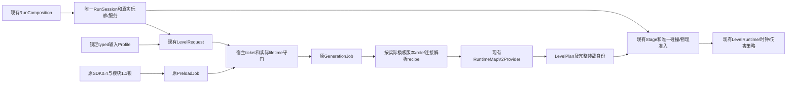

# 0.4升级实际进展

原0.3生产源7f65及其12fresh检查/最终Web保留在独立分支，不追签0.4。新包release6bf07ab5、sourceb21c8890、archive7aa3f0e5；新18GD原件、module1.1.0原5ad未改。

主游戏锁定4.7.2实际运行原0.4包verify109、foundation123、preload、reward_geometry、budget均exit0。verify是外部包project由主游戏wrapper/引擎执行；不能冒称宿主装载。基本测试完整日志见evidence。首次启动开发脚本两次参数/执行权限错误未进入引擎，不追称验证通过；随后用bash及manifest真实tests/dependencies/modules.zip执行。

另在实际主游戏project（--path本工作树）执行原SDK tests/suite.gd，原request/config无solver修改、无读取旧map作输入：930001 PASS，87175expansions，46instances/58connections，fp13f7f7f480168da132e64f478919450ca8bbe179e6614b9f30b5d0ac31c65772；930007 PASS，88856expansions，43instances/55connections，fpdeee1d69cc42840dfc5fae6648e8fc72f016dc2a450da53c94b787d30018f485。两结果map/content_store与已核官方各自结果完整相等。原始wrapper保留result与profile，耗时19.309秒（两case），无nativeERROR/泄漏。此中间生成使用首版04锁f3d6d217；后续将显式加入官方930007输入映射，新宿主验证须绑定最终锁。

此处仍不是SceneTree装配/真实Motor/浏览器证据；当前在迁移同一host job和实际选择recipe，待后续验证。SDK reward修正仅证明奖励区域不被原未连端口封口完整排除，不能证明物理通路、已授予能力或整图可玩。40布局全部改变是上游报告与静态核对，不是40张宿主物理回放。

## 明确的升级提交与当前验证

0.3保持独立PR128/3790ee9f0809fd65e08a39e4ff9b9401f2ce94aa；PR127 e7d及原172成功不变。0.4原SDK升级a60828ed6bfdb595ba8fd7abdb97d007b0f3f485；实际语义选择/共享宿主1c4d19800683a195bf1c51896104889749342ef8；两个CI产物期望的独立修订d4e17def6848dc75b9c6037436dee86ecc874cbc；真实Web失败后仅宿主调度与失败诊断f6b61ee7026bc4c696d15fa26b09de5ff03be903。没有重写求解器、普通出发、物理/经济/永久保存schema或美术音效。

新SDK23个锁定叶（18原GD+moduleZIP+两个原请求+配置+锁）完整SHA与升级/内部父目录符号链接拒绝经独立31pure和真实旧19/ZIP9例验证。默认install拒覆写，只有显式upgrade先验证旧19；无静默覆盖。最终锁09c2c213e1d0311a0d8417595201c262d3ab32dca23616b779e30d2ca5dffb62。

原Provider生成来源只3个版本限制迁移到0.4；冻结文件来源的转换/身份路径保持，旧Frozen实际199通过。两个来源仍汇合现有内部Plan转换，不新增RunSession/钱包/伤害/奖励权威。Host job控制preload→generate→validate→assemble→physics→commit，actuallifetime/token/opaquehandle拒旧、重复及退出结果。

新recipe只含模板版本/role/真实port邻域与原平台中心出生规则；不预置实例标签或世界坐标。930001实际解析结果恰仍M16/M18/M21，但世界原点已为[-384,768]/[-1152,640]/[-1920,640]，3内部边C026/C028/C029，出生[200,1102]。完整18源平台+2原封口+1ellipse保留。930001没有ferry-gears，当前M35是其他模块，不能套旧绑定。独立官方930007重新生成后唯一ferry-gears恰名M35，origin[384,384]、出生[474,974]；完整4平台（index2单向）、危带[428,1042,912,40]、relay_gear与ascent_0/1保留，不把外部邻居假装已装。两入口都经真实身体和三脚底支持后提交，无双镜像/重复源偏移。

| 请求 | 上游生成输入指纹 | 地图内容身份 | 宿主装载身份 |
| --- | --- | --- | --- |
| 930001 | 13f7f7f480168da132e64f478919450ca8bbe179e6614b9f30b5d0ac31c65772 | b58d4545c2dc7941e2e5160c099bcf8a4ab72db7977817c9b12c807792e75e93 | 0e6dea7c145ea2ab983b48189ffaaeb78f2797a7d6cf93254745500abddf9b1b |
| 930007 | deee1d69cc42840dfc5fae6648e8fc72f016dc2a450da53c94b787d30018f485 | c652943fe8e5e50c2b21242cc09530228a12d1a7fbfb08975977da5a4e835d97 | 6f1a6e262a765aa4025fafcedc683fd3f10161234d747f0d6675b16776f4cf3f |

身份区分原指纹/实际map+store/完整宿主选择绑定。原result未改写，memory没有map.json原字节声明，真实0.3旧记录及content/bindings变更均拒旧恢复；耗时变化不使相同内容身份漂移。

f6实际主Godot4.7.2原12项release fresh全部通过，222.429秒、0reuse；实际断言80/1633（随tick采样变化）/58/199/45/75/31/54/80/69/42/13。原manifest full178不变，所有旧命令/预算保留，只两个原check新增精确实际输出目录；两个测试等值期望迁移经独审，无删断言。主源原35586带未跟踪文档的d4运行与后续clean35466的f6运行分别保原快照，不混称同全树；f6自身35466源前后逐字节相同。

Job新增真实candidate_expansion_budget=1反例，实际SDK返回BUDGET_EXHAUSTED/growth/candidate_expansion_budget并原样转发；正常配置/随机/90秒上限完全未改。原2514/1的PREDELETE测试失败保留：新增await helper同帧临时强引用refcount3，下一帧退栈释放；只测试加一帧观察，原null/opaque断言及240秒守门保留，未改变生产析构或补close掩盖。

首次集中12因两个原CI fixture只期望旧03证据目录而在cheap前置54/2失败；独立迁移后54/0，再完整执行12，不以局部替代全量。首次Foundry因真实源失配拒绝；原工具36短句/18连续itinerary重新验证并stamp，56JSON差异只有326个basis/hash/manifest_hash叶，无几何/规则变更。第二次核查stamp本已通过，重验输出0diff，不伪称第二次失配。

## Web边界与真实失败

旧4ms源d4真实PCK26956c9830ce12e544eb9cc54ca732fa58b8187f1d347940cc2c479c4420c84d/218919752B：实际浏览器185.365秒内从预载进入生成，生成事件到失败92.521秒；宿主只给通用非PASS文本，无法追签具体SDK状态。没有loaded/committed/移动/退出/cancel/gear证明。原图、archive、前后源与完整旧bundle保留，明确REJECT。

f6改为原SDK样例相同的8ms软让出目标，并转发实际失败status/schema/error；每tick配置单位上限仍1..4096（默认128），每原advance1为16检查点。单单位可超过8/16ms，记录真实max/total/count与SDKphase统计，不声称硬预算。原native真实budget1反例不用于倒推旧Web根因。

新main4.7真实Web导出+原bundle检查通过，PCKbd23bbc7cf1fc36d471689c80f7108213e8978372f35c2790333f843a468c21b/218920072B；构建源前后相同。只允许唯一原moduleZIP及精确23叶/两recipe，原Frozen7继续保留；无Python、参考/测试ZIP或开发证据。实际browser18正常GD转换与JSON/ZIP读回已通过；新8ms浏览器其他结论以最终原raw为准，当前不预填全面PASS。

## 覆盖与下一批

map-edit PR78原producer增加显式actual-profile开发补丁，不另起提取器；旧43输入/两ZIP逐SHA和Gitblob恢复后，10输出原/新/原Git逐字一致，4旧缺件篡改拒绝。新两来源按各same-run result/provenance/原GDScript canonicalFP字节/resolved绑定/Provider/原源向量/原验证收据共7项锁，重新执行原producer。两新表46/58/21版本/13机制组与43/55/20版本/14组，共109/110完整机制对象；38新篡改反例全拒。原d4freeze保持，f6独立新目录再提取，实际map/store/所有机制/绑定/指纹全同，原result仅generation_seconds变化。所有新行UNVERIFIED_CURRENT_HOST，不能当全图物理通过。

下一批优选完整game-plains-windchime-lesson/start单safe_lesson钟门（无敌人奖励hook），复用正式ShotLatch/控制器/epoch，不造新伤害/资源权威。group_motion双船钟需真多目标接口，原bind_motion只单船；paired_gate/initial_open=B/open_seconds=0不能误当普通计时门。具体版本、两个真实seed/实例邻域、原封口与不支持内容见新覆盖next-mechanisms；不套旧M编号、不删邻居敌人凑连通。

整图/跨缝完整Motor路线、所有机制、敌人、奖励/Boss、普通controller请求通图、手机/硬帧预算与用户认可仍未验证；不替换普通地图，不合并/发布。

## 本轮原Web整段预算阻塞（不能签全绿）

8ms原default双fresh/总300秒actual-02与唯一零脚本变更复验actual-03均超时。第一会话真实72.44/72.43秒生成PASS、准确spawn/identity、D/A、ESC与Title均通过；第二会话仍在preload，未到generate/cancel，预算内原after-guards亦未完成。原报告整体FAILED，不能用首会话或预算外custody改写。离线附加custody只证明源/PCK/helper未变，明确在预算外。

actual-02四图之间28.981/40.006/20.757秒；actual-03直接view→command后仍31.94/24.55/25.06秒，均含实际审图/工具往返，不是纯游戏CPU。不能据总300超时宣称SDK90秒限额再次失败。没有再试默认consumer，没有修改原driver、300秒或任何CI预算。后续原gears单会话和明确标注的额外cancel-only缺口诊断即使通过，也只补分项功能证据，不补签原双fresh300回归通过。

actual-02原receipt显示8ms：preload1169tick/18949原advance1，均值9.629ms/tick、阶段墙钟27.072s；generation3154tick/94678原advance1，均值10.447ms/tick、SDKwall71.843s；validate137.161ms。128配置cap并非主要瓶颈（每tick平均preload16.21/generation30.02次）。这些是该软件浏览器/宿主环境实测，不是手机或硬8/16ms保证；不应为过整段测试扩大SDK90秒/候选预算或删互动检查。

## 最终独立Web分项

原gears单fresh/300秒case以230.323秒通过，实际930007生成43/55/43、出生[474,974]、host6f1a…；22样本10.5源钟秒/10.4803墙钟秒，双船和锯轮均真实运动、同一快照共享clock，实际危带[428,1042,912,40]/fall_plane/shared_policy；ESC清理并回原Title。7原PNG全部实看；第二船只有顶部边缘裁切，危险带以DEEPDROP标记可见，不能签完整同屏或全带可见。

额外NEW cancel-only diagnostic经独审精确4单行差异，原default driver字节不改；只选未完成的cancel case，保该case全部断言和独立300秒，最终状态明确TARGETED_ONLY。实际121.170秒通过：started/preload→generate→真实ESC→source_closed(cancelled)，无committed/loaded/physics，audio释放/lifetime失效/stage分离先于原Title。2原图实看、normal source/producer/PCK/served afterguards均通过。该诊断不是再试默认aggregate，也不补签它通过。

两独立case的正常35466源前后、producer/helper、PCK及served identity全同，browser/context/本地server均已关闭。保favicon404、Emscripten Blocking type:error与AudioContext自动播放warning，不能笼统写零console错误。原page/script/request/http监测项分别据raw记录。

完整CI基线PR128/run41595461174/3790的prepare、93parallel、85serial、affected全成功，178fresh/0reuse/0fail，原argv/预算/logSHA/源码与工具链前后和跨lane已独核。0.4本次原12fresh是f6的相关检查；最终交接metadata提交的CI以新PR精确head实际结果为准，不能拿父178或本地12代签新head full178。

## 当前依赖与职责

正式玩家由同一RunComposition创建；钱包/构筑/奖励/商店仍属于RunSession，policy/lifetime共享给Stage。SDK仅处理数据；SceneTree创建和实际body/foot准入在主线程。两个recipe和同一纯选择helper、同一Provider转换、同一physics admission复用，gears只增加其原profile与已有环境回退职责。

从切片到整图仍缺wall/thorns/hooks/latches、approved_hq_cells、敌人、reward_sites、Boss和完整图端点/多端口身体锚点等消费者；合法INPUT/OUTPUT连接尚无单向运行语义（协议外IN/OUT拒绝），selected内部当前INOUT/ROCK。完整路线与普通controller能力请求可通关尚未验证，不删不支持内容凑过。

正式出发下一轮只应将此数据来源job投递到已有正式RunSession/StageFlow；不要把实验RuntimeMapSlice整个嵌入正式App再创建RunSession。未来正式算法参考包继续同协议显式换锁，当前无Python运行依赖、无后台Thread或硬帧承诺。

回退目标为原0.3完整基线3790ee9f0809fd65e08a39e4ff9b9401f2ce94aa（PR128），原功能/包/输入/证据/CI均保留；不能只回退SDK或绑定位而留下混版本Provider。普通地图未替换，永久存档schema不变。
