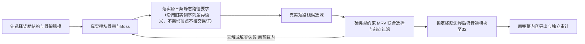

# 结构生成新算法实验报告

本轮记录并执行三种算法、四组显式配置的对照。新算法是实际纯数据GDScript求解，不是设计文档或预存地图。它证明可以将“六条多模块奖励折返”变成硬规划目标，但当前向前归并实现失败率高，不能默认替换旧算法，也没有同时解决成功率、尾部时间和主观重复感。

## 基线、版本与输入

仓库基线PR #10 head 941c7205bcdef017ef443a7edb438c019ff7ca87；新算法experimental-v6-structure-first，实现mapgen/gdscript-experiment-0.7.0+121edabc61b9，包0.7.0-experiment、research-prototype，25运行文件。实际源码commit/产物commit/ZIP SHA在交付记录及receipt，不能将后续PR提交冒充包内源码。

旧0.5.1/stable-v4、0.6.0/stable-v5冻结源码与产物保持原样。本轮60例对比覆盖v4/v5/v6，历史v3未在这批实际两能力请求下重跑，不以其旧四能力结果代替。新returns与merge是同一算法的两种配置，不计成两种独立算法。plan.json在实现前固定seed：8校准、930001–930040回归40、960001–960020新20；最终selection.json在扩展批次前锁定运行文件及两配置，之后没有调参、换seed、reroll或隐式回退。

主游戏原捕获请求：jump/shot_recoil，净空半尺寸12.0/18.0，保留JSON浮点类型；模块ZIP仍1.1.0、SHA 5ad5a7871941b2c1ffa759b18f7b1e80f2fe7e571b72f95d1e0ef26031f08723。目标32生长/6目标奖励/3主路径、90秒/500000候选、128终端状态、8修复、128生长回退/深度3、宽高比≤3和封口32像素不改。新算法将“生长实例”单独记录，闭环和奖励连接模块不充数。

## 实际实现的架构变化

首次把奖励结构作为必须完成的任务，而非候选得分：returns六条multi_return；merge一条forward_merge加五条multi_return。没有single_return回退。该额外设计要求必须与旧算法只保证32/6/3的工作量区别，不能将新旧时差解释成等价计算加速。

motif_catalog从真实模块、镜像、能力过滤有向Route和封口配置推导两模块折返，当前请求得到584条相对坐标候选；它们是模块局部组合，不是整图。每job可重建，计入原候选预算，不形成第二套模块源。当前末端仅覆盖单Port自返奖励房，两模块的去程和回程均须实际参与，不能添加无用房间伪装长支路。

实例化时按真实接口、倍增整数坐标、占地和所有奖励封口净空检查；每个实际根接口保留若干候选，再轮询收集，避免一个接口填满48候选池。有限域求解优先处理候选最少的奖励任务，以共享核心Port、AABB或跨支路连接构造冲突；删除不兼容候选并用兼容图着色给出保守上界。只对已枚举候选域剪枝，不把域为空写成“真实模块库全局无解”。

奖励完成后记录每个支路接口的实际连接集合，后续填充不得改变边界；每个模块/实例均由真实源完整输出，不移动或裁剪奖励，不补未声明反向Route，不打开未连接Port。最终继续原完整模块内容、实际有向图、普通/目标奖励、镜像和封口检查。

它仍是架构原型：骨架生长和闭环候选并非完整拓扑语法；向前归并候选还复用旧有界支路枚举。没有实现任意结构图的全局几何约束求解，也未预编译所有多Port奖励组合。因此不能宣称上一轮提出的整体架构已经完整落地。

## 同批效果

| 算法/配置 | 回归40 | 新20 | 合计交付成功 | 六多模块折返结构 | 一向前归并＋五多模块折返 |
|---|---:|---:|---:|---:|---:|
| 0.5.1 / stable-v4 | 37/40 | 19/20 | 56/60 | 0/60 | 0/60 |
| 0.6.0 / stable-v5 | 40/40 | 20/20 | 60/60 | 0/60 | 0/60 |
| 0.7.0 / 六条多模块折返 | 38/40 | 20/20 | 58/60 | 58/60 | 0/60 |
| 0.7.0 / 一归并＋五折返 | 10/40 | 3/20 | 13/60 | 0/60 | 13/60 |

新算法有额外结构硬要求，不能把旧算法未满足这些新风格的地图改判为旧协议失败。0.5.1有4个SEARCH_EXHAUSTED；0.6.0全部成功；新折返有1个SEARCH_EXHAUSTED（930006）和1个BUDGET_EXHAUSTED（930036）；新归并有32个SEARCH_EXHAUSTED和15个BUDGET_EXHAUSTED。新seed960011在旧v4失败，另外三组的实际结果均原样保留。

新折返58图共348条multi_return；新归并13图共13条forward_merge＋65条multi_return。旧v5的60图共331单房、14多模块折返、8异处归并、7向前归并。结构类型分母为各自成功图，不能直接用数量比较成功率。

旧40是已知回归集合，也包含若干校准seed；新20在选定源码/配置后一次执行，不据其结果修改算法。全部失败保留，SEARCH_EXHAUSTED和BUDGET_EXHAUSTED分开；失败map=null、content_store={}。批次summary的FAIL表示该配置没完成所有生成目标，不能改写成“套件全通过”。

与旧v5对比采用58个共同成功seed：

| 指标 | 旧v5 | 新折返 |
|---|---:|---:|
| 普通实例 | 38.328 | 41.914 |
| 普通源模块种类 | 23.603 | 31.500 |
| Port/Route结构类型 | 21.017 | 29.345 |
| 重复邻接对 | 8.362 | 2.138 |
| 跨图源集合相似度 | 0.557 | 0.512 |
| 跨图邻接集合相似度 | 0.136 | 0.075 |
| 归一化占用相似度 | 0.346 | 0.325 |

模块/邻接重复指标明显改善，宏观占用相似度略降，代价是更多普通实例和较差的成功率/尾部耗时。因骨架顺序、普通填充评分与候选单位同时改变，本轮不是逐项消融，不能将全部收益归给某单项。目标奖励末端仍仅两个源模块，不能把普通连接模块多样性当成奖励内容多样性。所有115个源模块的使用频率及覆盖图数在对应CSV，按共同成功图统计。

排除奖励支路内的连接模块后，同58个seed的核心普通模块实例37.655→35.914，源种类23.052→28.810，源种类/实例比例0.612→0.803，重复邻接8.310→1.707。核心自身亦有变化，收益不只是追加六个连接模块。

所有布局均仅在共同成功seed比较，分母与新增实例数同时保留。额外放入六个连接模块不能直接视为多样性提升。每个成功图的六条两模块支路确实通过独立导出图路径检查；向前归并只证明在冻结实际主路径上更靠后，不能证明物理上禁止返回。主观重复感、动作和整图物理未测。

## 为什么有向归并仍然失败

新原型把主线骨架提前构建，再尝试匹配奖励归并：时机比旧算法早，但仍先固定了两端位置。奖励路线必须同时满足方向、端点偏移、整数奇偶、空间占用和封口；已有有限候选未必存在匹配。大量失败不是奖励数量不足，而是选定骨架上没有搜到目标类型的完整组合。不能用增加奖励权重或六个折返作回退掩盖。

下一步有依据的架构方向是**联合构造分叉、奖励走廊、下游汇合以及主线绕行**，把它们作为一个可实现的结构单元，再扩展普通地图。仅将奖励检查前移，或者先随机画骨架再硬填目标，仍保留了原来的根本矛盾。本轮没有继续偷偷加入另一套生成器来挽救数据。

reward-route-inventory.json从锁定模块只读核对：26个可适配目标奖励模板中，当前能力下有23个模块声明不同Port间的奖励Route，3个声明自返奖励Route（二者可重叠），另有generated-09efd9583360ae3e414d7430c9b0e7e12a730b0fe8a5f19a90fc98c9b80c2ac2在当前能力下没有可用领奖Route；当前两模块折返目录只使用其中两个单Port自返末端idea-plains-hq04-001、idea-spec02-s13-001。batch30-d04-0同时存在A→C和A→A领奖Route但有两个Port，未进入当前单Port目录。这是原型覆盖限制，不是模块包缺失奖励字段。

本轮无需map-edit改输出格式或增加字段。多Port奖励组合、接口几何和能力匹配应先由生成器利用现有数据；只有找到具体且可复核的组合缺口，才应提出补模块。failure-analysis.json列全部失败、每轮有限域大小、实际尝试模块/Port坐标与镜像；它不冒充全局不可行证明。

## 独立性能与Web

锁定Godot4.7.2 SHA eeaec2b65dc3234168be1e1cbcc89731514bbb78dfb2c1b502920c50830a0638。原生按v4/v5/returns/merge/merge/returns/v5/v4串行、每seed两次取中位；无同时运行的生成任务或浏览器。生成墙钟含job准备、搜索、审计和导出；ZIP预载、结果复制和序列化另外记录。advance累计时长不是OS CPU时间。

| 同步原生生成秒 | 930001 | 930007 |
|---|---:|---:|
| 0.5.1/v4 | 4.706 | 3.088 |
| 0.6.0/v5 | 3.264 | 3.373 |
| 0.7.0/returns | 3.425 | 3.013 |
| 0.7.0/merge | 11.000 | 5.906 |

同500000候选上限不代表相同CPU工作单位：新算法编译/实例化motif与普通模块候选的工作不同。新折返在两个重点seed的成本接近旧v5，但全60诊断批次P95为9.748秒，对照旧v5为5.774秒；诊断批次有常规检查/不同历史批次环境，不能用它声称严格性能百分比。归并配置的返工与总计算量明显增加，不能靠更细让帧消除。

| 本轮实际线程Web生成秒（各一次） | 930001 | 930007 |
|---|---:|---:|
| 0.7.0/returns | 17.651 | 16.918 |
| 0.7.0/merge | 57.625 | 31.336 |

Web为真实导出、Compatibility/软件Chromium、COOP/COEP、advance(1)、128单位/软8ms宿主调度，四次成功完整结果与原生对应向量一致，仅排除generation_seconds；jump-only真实失败亦完整重放（共5项完整重放）。旧版Web证据复用上一轮冻结结果，本轮不把历史Web计时冒充同步四算法Web对照。

折返两次新建完整预载（冷/热文件缓存）4.309/3.735秒，本轮未优化预载；生成advance累计9.907/9.460秒，其余为宿主和让帧；最大单次advance 36.759/31.044ms，软8ms仍不保证硬帧上界。

归并两次新建完整预载（冷/热文件缓存）4.412/4.226秒，本轮未优化预载；生成advance累计32.857/17.756秒，其余为宿主和让帧；最大单次advance 36.820/37.270ms，软8ms仍不保证硬帧上界。

实际可信DOM输入到取消完成：motif_catalog阶段19.535ms，结果CANCELLED且无地图。这是一次观测，包含事件排队和推进到观察点，不是cancel函数自身耗时或所有阶段最坏上界。

实际可信DOM输入到取消完成：structure_domains阶段21.500ms，结果CANCELLED且无地图。这是一次观测，包含事件排队和推进到观察点，不是cancel函数自身耗时或所有阶段最坏上界。

原始phase计时按advance入口阶段归类，跨阶段那次调用计入入口，不冒充精确函数CPU剖析。全部分位数、复制/序列化、浏览器和导出文件摘要在native-bench和web-*报告。实际主游戏性能和整图可玩性NOT_RUN。

## 验证及保留失败

原型v1短骨架：两例均SEARCH_EXHAUSTED，保留。v2两例地图静态通过，但引擎退出码-6，整轮FAIL；新审计还未识别终端Port别名。v3将目录持有solver改为WeakRef，退出正常，补齐终端别名与普通奖励节点审计后通过。退出异常不再复现不等于证明了引擎内部根因。原失败日志保持原样，structural-reaudit.json单列重审数据，不清除v2进程异常。

最终源码修正最后一次布局修复结束时不得覆盖BUDGET_EXHAUSTED；随后锁定selection，再跑所有扩展和新seed。运行文件未因结果调参。每批保留完整request/config、source-lock、压缩运行源码、完整result/map/content_store以及失败。

两能力Job API32项通过，覆盖推进1/17/128/4096、结果快照、预算负例、输入/类型拒绝和取消；新增8项真实隔离检查：目录推导中取消一个job，另一个交错job完成后完整结果仍等于基线，库再次复用和嵌套配置快照不受污染。另11条合同记录覆盖冻结成功、真实jump-only失败、不同批次及motif_catalog/growth/structure_domains/reward_branches/final_audit/export六阶段取消，全部按预期通过。负预算测试显式使用小预算验证拒绝，生成效果比较仍使用原90秒/500000。

prototype/verify和verify_progress --replay通过，原20个历史seed连同四拒绝原样重放。0.4.1、0.4.2、0.5.0、0.5.1与0.6.0包SHA逐一核对不变。最终独立包需仓库外解压通过verify_bundle及CLI；最终收据记录其实际执行结果，不用GitHub可合并状态代替测试。

本轮未运行主游戏、整图物理、Web非线程构建、不同设备或跨Thread共享库；支持域外能力/净空组合未完成覆盖。不升级模块1.1.1，不加随机危险/布怪，不自动合并、部署或切正式锁。
